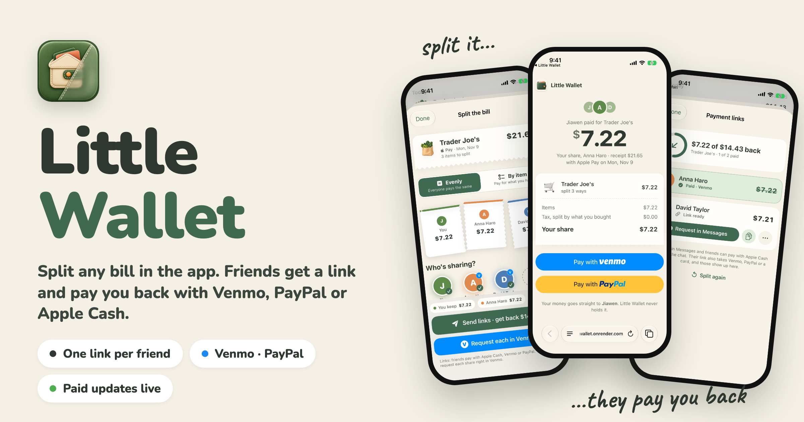
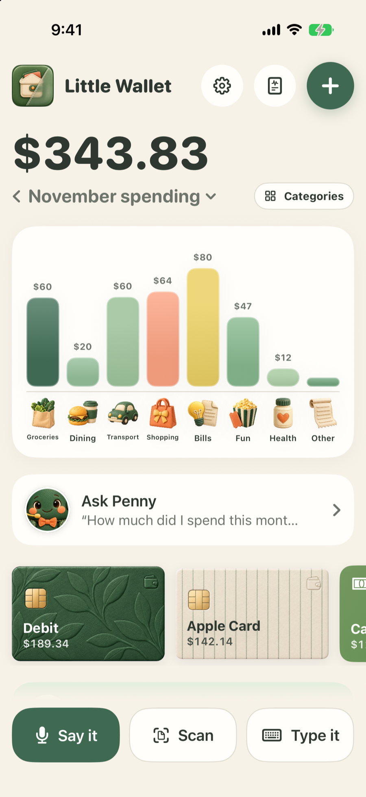
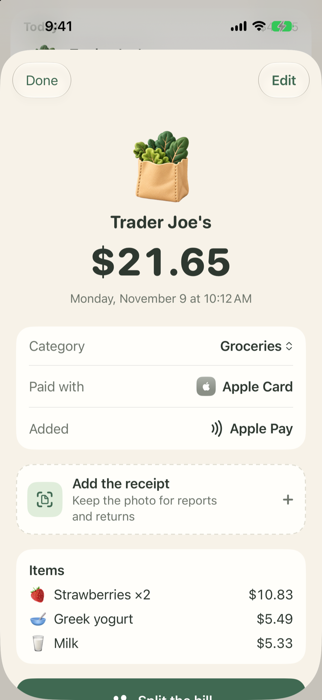
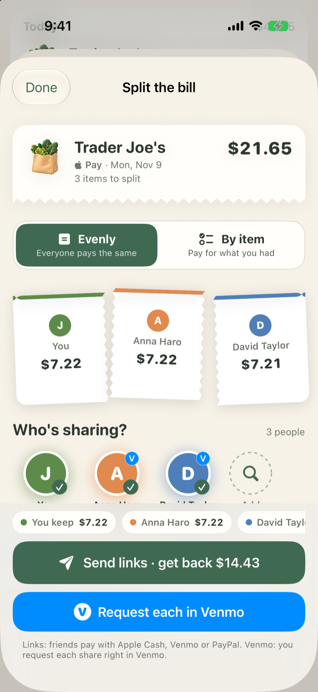
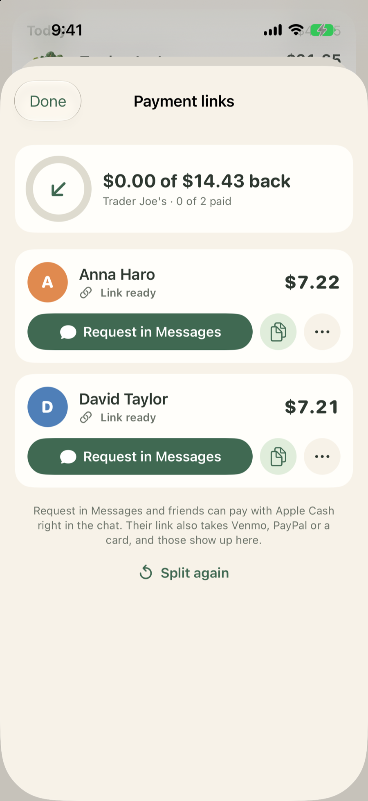
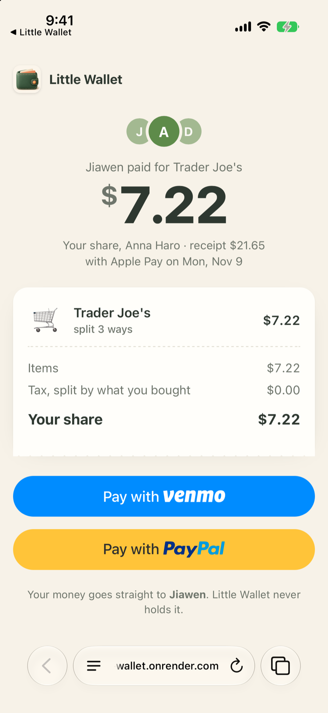
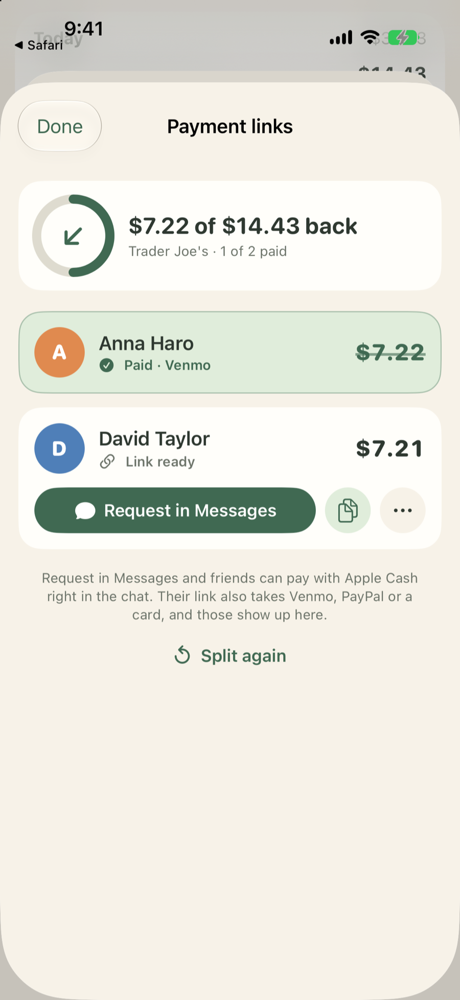
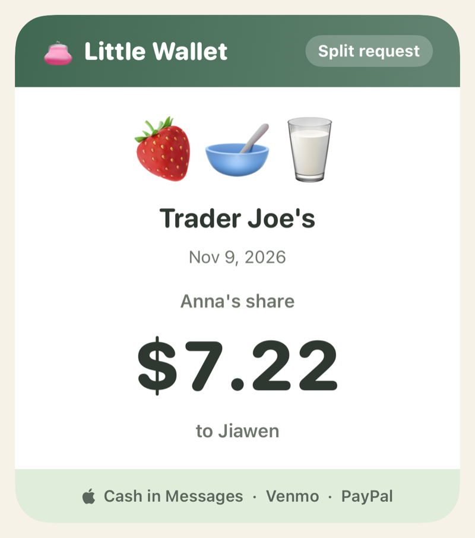
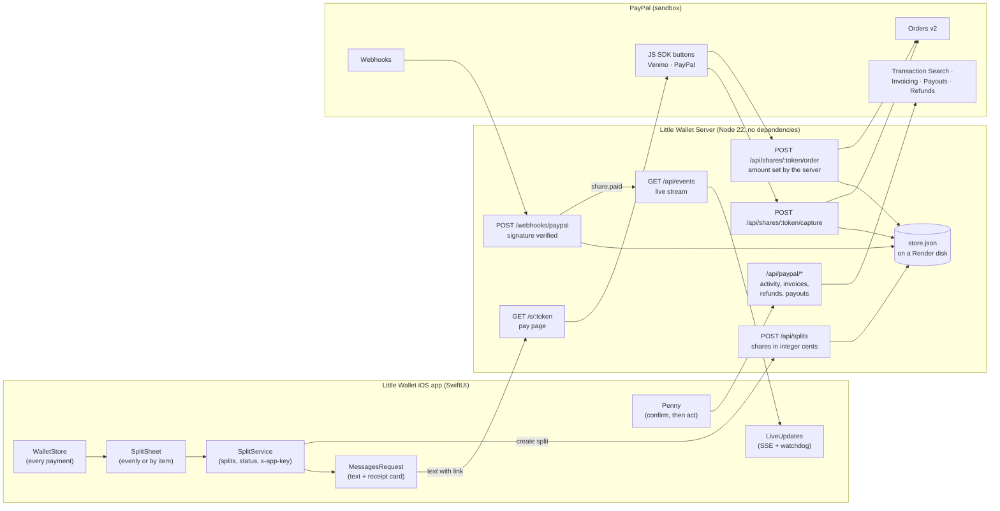

# 👛 Little Wallet Server 💸

[](https://nodejs.org)
[](https://developer.paypal.com/api/rest/)
[](https://developer.paypal.com/docs/checkout/pay-with-venmo/)
[](https://support.apple.com/apple-cash)
[](https://little-wallet.onrender.com/s/demo-sam)
[](#-verification--test-results)
[](https://paypalaihackathon.devpost.com/)
[](LICENSE)

> **Little Wallet** keeps every payment you make in one calm place: Apple Pay taps, receipts you scan, things you say
> or type. When a payment was shared, split it in a tap. Each friend gets a link with **only their share** and a big
> **Venmo** or **PayPal** button, or a text they can pay with **Apple Cash** right in Messages. The money goes straight
> to you, and the app shows **Paid** the moment it lands. Little Wallet never holds it.

This repo is the payment server behind those links: the friend's pay page, PayPal Orders, webhooks, the live line to
the phone, PayPal activity, and the PayPal actions Penny (the app's money helper) can take once you confirm them.
The iOS app is [JiawenZhu/little-wallet](https://github.com/JiawenZhu/little-wallet). Built for the
[PayPal AI Hackathon](https://paypalaihackathon.devpost.com/).

**Try a pay link:** [little-wallet.onrender.com/s/demo-sam](https://little-wallet.onrender.com/s/demo-sam) (PayPal
sandbox, so no real money moves).

---

## 📸 Visual Showcase

<div align="center">
  
</div>

<br/>

### 📱 The Whole Flow (Little Wallet on the iPhone 17 simulator, Nov 9, 2026)

| 1. Every Payment in One Place | 2. Open the Payment | 3. Who's Sharing? |
| :---: | :---: | :---: |
|  |  |  |
| **Spending by category, card and day** | **Items, card and receipt on one screen** | **Even or by item, exact to the cent** |

| 4. One Link Per Friend | 5. They Pay Back | 6. Paid, Live |
| :---: | :---: | :---: |
|  |  |  |
| **Request in Messages, or copy the link** | **Their share, one Venmo or PayPal button** | **The app updates the moment they pay** |

<sub>Every screen is a real capture of the current Little Wallet build with demo data and the simulator's sample
contacts (Anna Haro, David Taylor). The pay page in step 5 is served by the live Render deployment in PayPal sandbox.
Anna's payment in step 6 was sent with the server's sandbox-only test route, so no real money moved.</sub>

---

## 🌟 Key Features

### 1. ✂️ Split Any Payment
- **From any payment in the wallet**: an Apple Pay tap, a scanned receipt, a payment you said or typed. Open it and tap
  *Split the bill*.
- **Evenly or by item**: everyone pays the same, or each person pays for what they had. "You keep" shows your share.
- **Fair to the cent**: shares are computed in integer cents with largest-remainder rounding, and tax is spread in
  proportion to what each person bought, so the shares always add up to the receipt.
- **The server decides the amounts**: the app sends the split once; every share and every PayPal order amount is
  computed here, never taken from a browser.

### 2. 💸 Getting Paid Back
- **One link per friend** (`/s/<token>`): their share, their items, and who paid. Random tokens, and each page shows
  only that friend's part.
- **Venmo and PayPal buttons** from the PayPal JS SDK (`enable-funding=venmo`), backed by **PayPal Orders v2**. The
  order carries the Little Wallet name, and the friend's statement reads **LITTLE WALLET**.
- **A free Venmo fallback**: when PayPal can't offer Venmo on a phone, the page shows *Pay in the Venmo app*
  (`venmo://paycharge`) addressed to your Venmo handle, with the amount and note filled in.
- **Apple Cash in Messages**: *Request in Messages* opens a text with the amount, the link, and a receipt card the app
  draws. Apple has no API to prefill an Apple Cash amount, so the text tells your friend to tap + → Apple Cash.

<div align="center">
  
</div>

### 3. ⚡ Paid, Live
- **Webhooks**: `PAYMENT.CAPTURE.COMPLETED` and `INVOICING.INVOICE.PAID` are checked with PayPal's signature
  verification, then the share is marked paid, even if the friend closed the page.
- **A live line to the phone**: Little Wallet keeps one Server-Sent Events request open (`GET /api/events`). When a
  friend pays, the share turns **Paid** and the app shows "Anna paid you $7.22" within seconds.
- **Only the app may listen**: the stream and every app route need the `x-app-key` header.

### 4. 📊 PayPal & Venmo Activity
- **What came in and went out**: the app's PayPal & Venmo card reads your PayPal account through **Transaction
  Search**, up to a year back, 31 days per request.
- **Matched to your splits**: a friend's payment for a split arrives with that split's title and items; money you
  sent shows as spending.

### 5. 🤖 Penny's PayPal Actions (you confirm first)
Penny, the money helper in Little Wallet, can draft PayPal actions. Nothing is sent until you tap to confirm on the
phone; this server then calls PayPal:
- **Invoices** (PayPal Invoicing v2): one per friend who still owes, emailed when there's an address.
- **Refunds**: back to a friend, never more than they paid.
- **Payouts**: to an email or phone; Venmo payouts go by phone number.

### 6. 🏷️ Little Wallet Everywhere
The pay page, the PayPal checkout name, the Venmo note and the bank-statement text all say Little Wallet. (Each split
carries the app that made it, so a sister app can share this server without borrowing the name.)

---

## 📐 Technical Architecture



### How the money moves

```
Friend's phone ── /s/<token> pay page ── Venmo / PayPal button (PayPal JS SDK, enable-funding=venmo)
                         │
Server (Node 22) ────────┤ POST /api/shares/:token/order    → PayPal Orders v2, amount set by the server
                         │ POST /api/shares/:token/capture  → capture, check amount + custom_id, mark paid once
                         │ POST /webhooks/paypal            → verify signature, mark paid even if the page was closed
                         │ GET  /api/events                 → tell the phone right away
                         ▼
Your PayPal / Venmo balance          (free paths: venmo://paycharge, or Apple Cash in Messages, marked by hand)
```

- **The server sets every amount.** The browser only says which share it's paying.
- Each order's `custom_id` is `<split>|<person>`. A capture or webhook marks a share paid only if the amount and
  `custom_id` match, and a replay never pays twice.
- Venmo's own developer API is retired, so Venmo payments go through PayPal Checkout.

### Fair-share math

Each line's price $c$ is split evenly among the $n$ people who had it, and the extras $E$ (tax, tip, fees) are spread in
proportion to each person's item subtotal $s_i$:

$$\text{share}_i = \sum_{\text{lines } \ni i} \frac{c}{n} \; + \; E \cdot \frac{s_i}{\sum_j s_j}$$

Every division uses largest-remainder rounding in whole cents, so $\sum_i \text{share}_i$ always equals the receipt total
exactly ([`server/split.js`](server/split.js)).

---

## 🔌 API

| Method & path | Who calls it | What it does |
| :--- | :---: | :--- |
| `GET /api/config` | pay page | Public PayPal client ID and environment (also Render's health check). |
| `GET /s/:token` | friend | The pay page (`web/settle.html`). |
| `GET /api/shares/:token` | pay page | A friend's share: items, tax, total, organizer, branding. Viewing marks it *opened*. |
| `POST /api/shares/:token/order` | pay page | Creates a PayPal order with the amount taken from the server. |
| `POST /api/shares/:token/capture` | pay page | Captures the approved order and marks the share paid if everything matches. |
| `POST /webhooks/paypal` | PayPal | Verifies the signature; marks shares and invoices paid. |
| `POST /api/splits` | app 🔑 | Creates a split: people, lines, extras, organizer. Returns one link per friend. |
| `GET /api/splits/:id` | app 🔑 | Who has opened or paid. |
| `GET /api/events` | app 🔑 | Server-Sent Events stream of `share.paid` and invoice events. |
| `GET /api/paypal/activity` | app 🔑 | PayPal account activity (Transaction Search), newest first. |
| `POST /api/paypal/invoices` | app 🔑 | Sends PayPal invoices Penny drafted and you confirmed. |
| `POST /api/paypal/refunds` | app 🔑 | Refunds a capture, never more than was paid. |
| `POST /api/paypal/payouts` | app 🔑 | Sends a payout to an email or phone (Venmo by phone). |
| `POST /api/demo/paid` | app 🔑 | Sandbox only: sends a test "paid" event for demos. Off when `PAYPAL_ENV=live`. |

🔑 needs the `x-app-key` header. Cross-site `POST` requests are refused (the `Origin` must match the host), except
PayPal's webhook.

---

## 📁 Project Structure

```
little-wallet-server/
├── README.md                     # This guide
├── LICENSE                       # MIT License
├── SPIKE.md                      # Day-1 findings: what PayPal sandbox allows
├── package.json                  # Node 22, zero runtime dependencies
├── render.yaml                   # Render service: Starter plan + 1 GB disk (secrets set in the dashboard)
├── .env.example                  # Every setting the server reads
│
├── server/
│   ├── index.js                  # HTTP server, routes, webhooks, branding, static files
│   ├── paypal.js                 # PayPal REST calls and webhook signature check
│   ├── split.js                  # Integer-cent split math and Venmo links
│   ├── store.js                  # JSON-file storage (on the Render disk in production)
│   ├── events.js                 # Live Server-Sent Events line to the phone
│   ├── activity.js               # PayPal Transaction Search, 31 days at a time
│   ├── actions.js                # Penny's invoices, refunds and payouts
│   └── register-webhook.mjs      # Points both PayPal apps' webhooks at a server
│
├── web/
│   ├── index.html                # Landing page
│   ├── settle.html               # The friend's pay page
│   ├── settle.js                 # PayPal / Venmo buttons and the Venmo-app fallback
│   ├── style.css                 # Little Wallet look: paper, green, rounded
│   └── img/                      # Little Wallet mark and item art
│
├── data/
│   └── demo.json                 # Demo split behind /s/demo-sam
│
├── spike/                        # One-off sandbox scripts used for SPIKE.md
├── tests/                        # node --test: split math, orders, webhooks, branding, live stream, activity, actions
└── docs/images/                  # README banner and screenshots
```

The production copy of this server lives in [`backend/`](https://github.com/JiawenZhu/little-wallet/tree/main/backend)
of the Little Wallet app repo, which is what Render deploys; this repo mirrors it.

---

## 🧪 Verification & Test Results

```bash
$ npm test
# tests 15
# pass 15
# fail 0
```

| Test | What it proves |
| :--- | :--- |
| **spread always adds up to the total** | Largest-remainder rounding never loses or invents a cent. |
| **shared items and tax split so shares equal the receipt** | Shared lines and proportional tax add up to the receipt. |
| **unassigned items are rejected** | Every line needs at least one person. |
| **Venmo link prefills recipient, amount and note** | The free `venmo://` and web links are built correctly. |
| **orders pay the organizer, use server amounts, and only matching captures mark a share paid** | Amounts come from the server; wrong amounts or `custom_id`s are ignored. |
| **the pay page and PayPal show the app that made the split** | Little Wallet's name, logo and statement text (`LITTLE WALLET`). |
| **splits survive a restart in DATA_DIR** | Links keep working after a deploy, from the Render disk. |
| **a paid invoice reaches the phone's live stream, and only the app may listen** | Webhook → live event; no app key, no stream. |
| **a friend's Venmo payment for a split comes in with its split, items and fee** | Activity is matched to the split it paid. |
| **payments out are spending; holds, adjustments and denied payments are left out** | Activity shows only real money in and out. |
| **long ranges are read 31 days at a time, every page, without repeats** | Transaction Search limits are respected. |
| **an invoice is emailed when there's an address, and its link comes back** | Penny's invoices reach friends. |
| **without an email the invoice isn't emailed; bad amounts are refused** | No surprise emails or broken invoices. |
| **a refund can't be more than the payment** | Refunds are capped. |
| **payouts go to emails or phones, Venmo by phone only** | Payout recipients are valid. |

The Little Wallet app has its own 75 passing tests (splits, receipts, reports, recurring bills, Penny's memory and
actions, live updates). **Live checks on Render (Nov 9, 2026):** app routes refuse requests without the app key; a
split made with it returns a `little-wallet.onrender.com` link; that page shows Little Wallet branding; and its PayPal
sandbox order reads back with the statement text `LITTLE WALLET`.

---

## 🚀 Quick Start & Local Setup

### Prerequisites
- **Node.js** 22 or newer (no `npm install` needed: there are no runtime dependencies)
- A **PayPal sandbox** REST app ([developer.paypal.com](https://developer.paypal.com)) and a sandbox personal account to
  pay with. A second sandbox app with Transaction Search turned on (`ALT_*`) powers activity, invoices, refunds and
  payouts.

### 1. Clone and configure
```bash
git clone https://github.com/JiawenZhu/little-wallet-server.git
cd little-wallet-server
cp .env.example .env
```
Fill in `PAYPAL_CLIENT_ID` and `PAYPAL_CLIENT_SECRET` from your sandbox app, and pick any long random `SPLIT_APP_KEY`
(the app sends the same value). Leave `ORGANIZER_MERCHANT_ID` empty to pay the account that owns the app.

### 2. Run the tests
```bash
npm test
```

### 3. Start the server
```bash
npm run dev
```
Open `http://localhost:8787/s/demo-sam` for Sam's share of the demo split. In sandbox, the Venmo button opens PayPal's
"Venmo Sandbox" page; sign in with one of PayPal's documented sandbox test users, never a real account.

### 4. Connect Little Wallet
In the [app repo](https://github.com/JiawenZhu/little-wallet), put the same key in `Config/Secrets.xcconfig` as
`SPLIT_APP_KEY`. The simulator talks to `localhost:8787`; a real iPhone uses `https://little-wallet.onrender.com`.

### 5. Deploy to Render
The live service `little-wallet` runs on [Render](https://render.com): Starter plan ($7/month) with a 1 GB disk at
`/var/data`, so saved splits and links survive deploys. The $50 PayPal AI Hackathon credit covers it through judging
(December 1–15, 2026).
- **Secrets** are set in the Render dashboard, never in Git: `PAYPAL_CLIENT_ID`, `PAYPAL_CLIENT_SECRET`,
  `PAYPAL_BN_CODE`, `ALT_CLIENT_ID`, `ALT_CLIENT_SECRET`, `ALT_BN_CODE`, `ORGANIZER_MERCHANT_ID`, `SPLIT_APP_KEY`.
- **Settings**: `PAYPAL_ENV=sandbox`, `DATA_DIR=/var/data`, `PUBLIC_URL=https://little-wallet.onrender.com`.
- **Webhooks**: `node --env-file=.env server/register-webhook.mjs https://little-wallet.onrender.com` points both
  PayPal apps at `/webhooks/paypal` and prints `PAYPAL_WEBHOOK_ID` and `ALT_WEBHOOK_ID` for the dashboard.

---

## 🗺️ Roadmap

- [x] Pay page with Venmo and PayPal (Orders v2), server-set amounts, webhook-confirmed payments
- [x] Little Wallet: split evenly or by item, payment links, Messages + Apple Cash receipt card
- [x] Live "paid" updates on the phone (webhooks + Server-Sent Events)
- [x] PayPal activity, and Penny's invoices, refunds and payouts with confirmation
- [x] Deployed on Render with a persistent disk and live sandbox webhooks
- [ ] PayPal live mode after partner onboarding, so friends can pay any organizer
- [ ] A database instead of the JSON file, and Apple Pay on the pay page

---

## 🛡️ Security & Privacy Notice

- **Zero hardcoded secrets**: PayPal credentials and the app key live only in the untracked `.env` and in Render's
  dashboard. `.gitignore` excludes `.env` and the live `data/store.json`.
- **Only Little Wallet can make splits or act**: every app route and the live stream need the `x-app-key` header.
- **Amounts are never trusted from the browser**: the server computes every share and every order amount.
- **Verified payments only**: captures must match the share's amount and `custom_id`; webhooks must pass PayPal's
  signature check.
- **Penny never acts alone**: invoices, refunds and payouts run only after you confirm them in the app.
- **Little Wallet never holds money**: payments go straight from the friend to your PayPal or Venmo.
- **Share links are random tokens** and show only that friend's share, never anyone else's.

---

## 📜 License & Credits

Created with ❤️ by **Jiawen Zhu**.
- Payments by [PayPal](https://developer.paypal.com) and [Venmo](https://venmo.com) through PayPal Checkout.
- Hosted on [Render](https://render.com).
- Distributed under the [MIT License](LICENSE).
